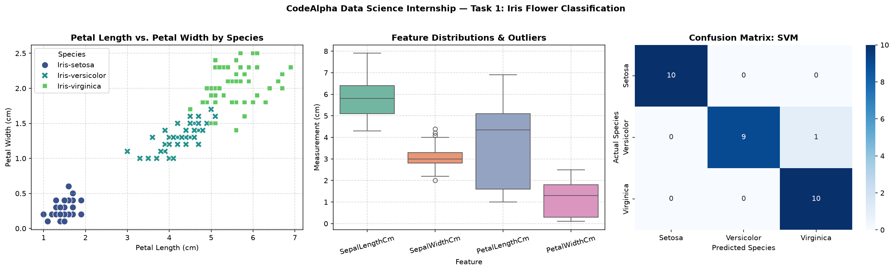

# CodeAlpha_IrisFlowerClassification
CodeAlpha Data Science Internship - Task 1: Iris Flower Classification using Python and Scikit-Learn.

## Model Accuracy on Test Data
- Support Vector Machine (SVM): 96.67%
- K-Nearest Neighbors (KNN): 93.33%
- Logistic Regression: 93.33%
- Random Forest: 90.00%

